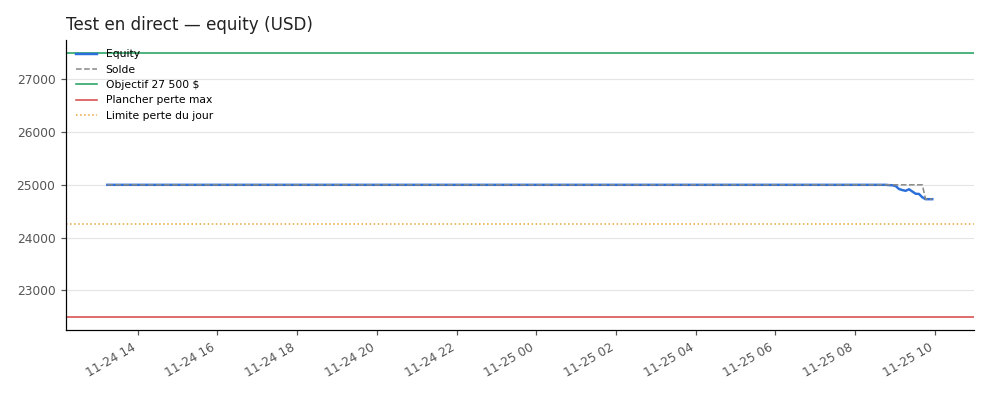
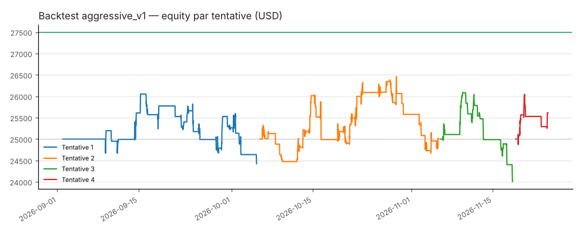

# RAPPORT — Simulation FTMO Challenge 1-Step 25 000 $ (paper trading)

> **EN COURS** — solde 25 000.00 $ — perte du jour 0.00 $ / 750 $ — distance au plancher 2 500.00 $ — mis à jour 2026-11-24T13:14 UTC

⚠️ Simulation uniquement : aucun argent réel, aucun compte de courtage ni FTMO connecté.

## Sommaire
1. Verdict
2. Test en direct
3. Backtest de validation
4. Audit du repo source
5. Fonctionnement du simulateur
6. Limites du test

## 1. Verdict

**Non. Avec `aggressive_v1` telle quelle, la probabilité réaliste de passer le challenge FTMO 1-Step 25k en 3 jours est quasi nulle, et elle reste faible même sans limite de temps.**

Pourquoi :
1. **Les chiffres ne collent pas.** Atteindre +2 500 $ en 3 jours avec un risque de 250 $ par trade demande ≈ +10 R nets en 3 jours. La stratégie prend ≈ 1,8 trade par jour (une seule cassure par instrument et par séance), soit ≈ 5–6 trades en 3 jours : même avec un taux de réussite de 100 % à 2 R on plafonne vers +2 500 / +2 800 $, et sur l'historique le taux de réussite est d'environ 38 %.
2. **Aucun avantage statistique démontré.** Sur 60 jours de trading et ≈ 100 trades, le profit factor est < 1 (P&L net négatif après frais). La seule période un peu positive est celle qui a servi à choisir les instruments ; la période de validation hors échantillon est nettement perdante. Toutes les fenêtres glissantes de 3 jours du backtest échouent à atteindre l'objectif.
3. **Les coupe-circuits demandés protègent du « challenge échoué », pas de l'échec économique.** Aucune règle FTMO n'a été violée en backtest (perte du jour plafonnée à 600 $, refus des trades trop risqués), mais la règle « pas de trade si distance au plancher < 3 × risque » **fige le compte** dès ≈ 1 750 $ de baisse depuis le plus haut : c'est la cause de toutes les tentatives terminées. Le compte n'est jamais « recalé » ; il devient inutilisable, ce qui coûte autant que les 199 €.
4. **Le Best Day Rule et l'arrêt à +1 250 $/jour** imposent de répartir le gain sur ≥ 2 bons jours : impossible à garantir avec 1–2 trades par jour.

Ce qu'il faudrait pour avoir une chance : une stratégie avec un avantage mesuré sur des centaines de trades (pas 100), testée sur plusieurs années de données (payantes ou données 1 h de Yahoo sur 2 ans), et un objectif sans contrainte de 3 jours (le 1-Step n'a pas de limite de temps : viser 2–6 semaines à 0,5 % de risque par trade est bien plus réaliste que « agressif en 3 jours »).

Le test en direct d'une semaine (5 jours de marché, section 2) ne changera pas ce verdict, quel que soit son résultat : 5 jours de trading restent statistiquement insignifiants. Sur le backtest, **aucune des 56 fenêtres glissantes de 5 jours n'atteint +2 500 $** (24 terminent en gain, 31 en perte, 1 compte bloqué par le coupe-circuit plancher).

## 2. Test en direct

- Stratégie active : `aggressive_v1` — premier lancement : 2026-11-24T13:14:13.465556+00:00 UTC — fin du test : **2026-12-01** (heure de Prague)
- Dernière exécution : 2026-11-24T13:14:13.465556+00:00 UTC
- Solde : **25 000.00 $** — equity : 25 000.00 $ — plancher perte max : 22 500.00 $ — plus haut solde de fin de journée : 25 000.00 $

### P&L par jour (trades clôturés, jour de Prague)

| Jour | P&L clôturé |
|---|---:|
| — | — |

### Règle du meilleur jour

Aucun jour positif pour l'instant.

### Positions ouvertes

Aucune.

### Journal des trades

| Instr. | Sens | Entrée (UTC) | Prix | Sortie (UTC) | Prix | Motif | P&L | Solde |
|---|---|---|---:|---|---:|---|---:|---:|
| — | | | | | | aucun trade pour l'instant | | |

### Coupe-circuits déclenchés

Aucun.

## 3. Backtest de validation

Backtest de `aggressive_v1` avec exactement le même moteur que le test en direct (règles FTMO, spread, commission, glissement pessimiste doublé sur les stops, plus haut/plus bas des bougies, coupe-circuits). Données : bougies 5 min Yahoo Finance (maximum gratuit ≈ 60 jours calendaires, soit 60 jours de trading). Une nouvelle tentative de 25 000 $ démarre le jour suivant chaque réussite, échec ou blocage.

| Période | Dates | Trades | % gagnants | Profit factor | P&L net | Tentatives terminées | Réussies | Échouées/bloquées |
|---|---|---:|---:|---:|---:|---:|---:|---:|
| Ajustement | 2026-09-02 → 2026-10-23 (38 j) | 63 | 41 % | 1.03 | 242.32 $ | 1 | 0 | 1 |
| Validation (hors échantillon) | 2026-10-26 → 2026-11-24 (22 j) | 45 | 33 % | 0.70 | -2 091.26 $ | 2 | 0 | 2 |
| Complet | 2026-09-02 → 2026-11-24 (60 j) | 108 | 38 % | 0.88 | -1 848.94 $ | 3 | 0 | 3 |

**Détail des tentatives (période complète)**

| # | Statut | Début | Fin | Jours | Solde final | Trades | Raison |
|---|---|---|---|---:|---:|---:|---|
| 1 | BLOQUÉ | 2026-09-02 | 2026-10-05 | 24 | 24 152.69 | 34 | bloqué: distance au plancher 599 $ < 3 × risque |
| 2 | BLOQUÉ | 2026-10-06 | 2026-11-05 | 23 | 24 469.73 | 46 | bloqué: distance au plancher 622 $ < 3 × risque |
| 3 | BLOQUÉ | 2026-11-06 | 2026-11-18 | 9 | 23 914.99 | 20 | bloqué: distance au plancher 334 $ < 3 × risque |
| 4 | INACHEVÉ | 2026-11-19 | 2026-11-24 | 4 | 25 613.60 | 8 | fin des données |

- **Taux de réussite** : 0/3 tentatives terminées (0 %) ; **en 3 jours ou moins** : 0 %.
- **Départ un jour quelconque, fenêtre de 3 jours** (58 fenêtres glissantes) : en perte : 37, en gain : 21. Aucune fenêtre n'atteint +2 500 $.
- **Durée moyenne** : réussite — j ; échec/blocage 18.7 j.
- **Cause d'échec la plus fréquente** : bloqué par coupe-circuit plancher (pas une violation FTMO, mais plus aucun trade possible) (3).
- **Coût** : 3 tentatives × 199 € (≈ 214.92 $) = **644.76 $** de frais, pour 0 compte(s) financé(s) ; gain potentiel attendu par tentative (90 % × 2 500 $ × taux de réussite) ≈ **0.00 $**. Espérance nette par tentative ≈ **-214.92 $**.

### Backtest semaine par semaine (un challenge neuf de 25 000 $ chaque lundi, 5 jours de marché)

Même moteur, mêmes frais et coupe-circuits que le test en direct. Chaque semaine est indépendante. Semaine du 14/09 : US100 n'a de données qu'à partir du 16/09 et son ATR n'est disponible qu'en fin de semaine.

| Semaine | Issue | P&L | Solde final | Solde le plus bas (clôtures) | Trades (gagnants) | Meilleur jour | Pire jour |
|---|---|---:|---:|---:|---:|---:|---:|
| 2026-09-14 → 2026-09-18 | objectif non atteint | 781.39 $ | 25 781.39 $ | 25 000.00 $ | 7 (4) | 617.62 $ | -483.10 $ |
| 2026-09-21 → 2026-09-25 | objectif non atteint | -783.31 $ | 24 216.69 $ | 24 147.60 $ | 9 (3) | 260.93 $ | -485.92 $ |
| 2026-09-28 → 2026-10-02 | objectif non atteint | -352.89 $ | 24 647.11 $ | 24 647.11 $ | 11 (4) | 736.40 $ | -498.15 $ |
| 2026-10-05 → 2026-10-09 | objectif non atteint | -1 010.37 $ | 23 989.63 $ | 23 989.63 $ | 10 (2) | 122.91 $ | -486.10 $ |
| 2026-10-12 → 2026-10-16 | objectif non atteint | 514.59 $ | 25 514.59 $ | 25 000.00 $ | 10 (5) | 830.62 $ | -527.20 $ |
| 2026-10-19 → 2026-10-23 | objectif non atteint | 1 099.28 $ | 26 099.28 $ | 24 756.04 $ | 11 (6) | 586.89 $ | -271.90 $ |
| 2026-10-26 → 2026-10-30 | objectif non atteint | -511.13 $ | 24 488.87 $ | 24 488.87 $ | 9 (3) | 251.99 $ | -495.10 $ |
| 2026-11-02 → 2026-11-06 | objectif non atteint | -1 000.71 $ | 23 999.29 $ | 23 891.26 $ | 10 (2) | 226.92 $ | -494.26 $ |
| 2026-11-09 → 2026-11-13 | objectif non atteint | -119.60 $ | 24 880.40 $ | 24 880.40 $ | 12 (5) | 972.92 $ | -489.87 $ |
| 2026-11-16 → 2026-11-20 | objectif non atteint | -543.28 $ | 24 456.72 $ | 23 674.66 $ | 12 (4) | 566.85 $ | -488.66 $ |

**Bilan sur 10 semaines :** 0 réussite(s) du challenge, 3 semaine(s) en gain, 7 en perte ; P&L cumulé -1 926.03 $ (moyenne -192.60 $/semaine) ; meilleure semaine 2026-10-19 (1 099.28 $), pire semaine 2026-10-05 (-1 010.37 $). Objectif requis : +2 500 $ en une semaine.

Détail des trades — semaine du 16/11 (dernière semaine complète)

| Sortie (UTC) | Instr. | Sens | Motif | P&L | Solde |
|---|---|---|---|---:|---:|
| 2026-11-16T10:45 | GER40 | long | stop-loss | -246.97 | 24 753.03 |
| 2026-11-16T20:45 | US100 | short | clôture fin de journée | 146.93 | 24 899.96 |
| 2026-11-17T10:10 | EURUSD | long | stop-loss | -239.15 | 24 660.81 |
| 2026-11-17T10:40 | GER40 | short | stop-loss | -245.59 | 24 415.22 |
| 2026-11-18T09:10 | GER40 | long | stop-loss | -246.94 | 24 163.73 |
| 2026-11-18T10:10 | EURUSD | short | stop-loss | -241.72 | 23 926.56 |
| 2026-11-19T09:15 | GER40 | long | stop-loss | -245.92 | 23 674.66 |
| 2026-11-19T10:45 | EURUSD | long | objectif | 322.84 | 24 003.48 |
| 2026-11-19T20:05 | US100 | short | objectif | 489.93 | 24 493.41 |
| 2026-11-20T10:00 | GER40 | short | objectif | 456.41 | 24 946.57 |
| 2026-11-20T12:45 | EURUSD | short | stop-loss | -244.08 | 24 705.73 |
| 2026-11-20T15:20 | US100 | long | stop-loss | -249.01 | 24 456.72 |

**Ajustement (une seule fois, sur la période d'ajustement uniquement, avant le 23/10/2026) :**
1. Backtest instrument par instrument avec les paramètres par défaut (range 15 min, fenêtre d'entrée 2 h, RR 2, filtre ATR 0,08–0,60, filtre de tendance clôture de la veille). Profit factor sur la période d'ajustement : US100 1,07 ; GER40 1,02 ; EURUSD 1,31 ; GBPUSD 0,74 ; US30 0,41 ; XAUUSD 0,24.
2. **Seul changement retenu : sélection des instruments US100, GER40, EURUSD** (profit factor > 1 sur l'ajustement). Une variante RR 1,5 a été testée et **rejetée** (pire : PF 0,74 contre 0,83 sur le portefeuille). Aucun autre paramètre n'a été touché.
3. La période de validation (24/10 → 24/11/2026), jamais utilisée pour choisir, sert de test hors échantillon : elle est nettement **perdante** (PF ≈ 0,7), ce qui confirme que la sélection d'instruments relevait surtout du bruit sur un si petit échantillon.

Note : un 4ᵉ instrument n'a pas été ajouté car aucun autre n'était positif ; réduire à 2 aurait été de la sur-optimisation.

## 4. Audit du repo source

Repo audité : <https://github.com/Jakeschincariol/day-trader-skill> (licence MIT), lu intégralement avant toute exécution (11 skills, ~8 500 lignes Python + tests).

**Sécurité — rien de suspect trouvé :**
- Python 3 bibliothèque standard uniquement, aucune dépendance à installer, aucun `eval`/`exec`, aucun code obfusqué ni base64.
- Seuls appels réseau : endpoints publics gratuits et sans clé — Yahoo Finance (`query1/query2.finance.yahoo.com`, flux RSS), Stooq, Nasdaq Trader (listes de symboles), SEC EDGAR, House Clerk (déclarations du Congrès). Aucun envoi de données personnelles (seul un User-Agent avec nom/email est demandé par la SEC, à fournir par l'utilisateur).
- Un seul `subprocess` : `pdftotext` local pour lire les PDF du Congrès (`trader-pelosi`).
- `trader-broker` ne passe **aucun** ordre : il fabrique un ticket que Claude envoie à un serveur MCP courtier (Alpaca par défaut, paper par défaut) uniquement après un « oui » explicite. Aucun service payant appelé.

**Ce que fait le skill :** un pack de 11 skills orientés **actions US** (pas CFD, pas forex, pas FTMO) :
| Skill | Rôle |
|---|---|
| trader-scanner | Scan de milliers d'actions US : cassures du range d'ouverture (ORB, bougies 5 min, range des 15 premières minutes), bull flags, RSI survendu / rebond |
| trader-entry | Surveille un setup bougie par bougie (ORB, cassure de niveau) et signale l'entrée à la clôture d'une bougie au-delà du range |
| trader-exit | Place stop (autre côté du range / ATR) et objectif (multiple de R) avant l'entrée |
| trader-timemachine | Monte-Carlo (10 000 sessions rééchantillonnées) + historique des fois où le setup a fonctionné |
| trader-risk / trader-budget | Limites de perte, taille de position selon le risque max par trade |
| trader-broker | Tickets d'ordres (Alpaca, paper par défaut), jamais sans confirmation |
| trader-alerts, trader-news, trader-analyst, trader-pelosi | Alertes de prix, news, analyse de résultats (SEC), déclarations de trades du Congrès |

Unités de temps : bougies 5 min (intraday), 1 jour (scanner quotidien). Signaux : ORB, cassures de niveau, flags, RSI. Gestion du risque : risque fixe par trade, stop obligatoire, R-multiples.

**Conclusion de l'audit :** le skill ne contient pas de « stratégie gagnante » backtestée : c'est une boîte à outils pour actions US. Son seul setup intraday mécanique est l'**ORB 15 minutes en 5 min**, c'est donc lui qui sert de base à `aggressive_v1`, transposé aux sessions de Londres et New York sur les CFD FTMO. Le code du skill n'est pas copié tel quel (il cible des actions et l'API Yahoo brute) ; le simulateur réimplémente la logique ORB dans un module séparé.

## 5. Fonctionnement du simulateur

- **Workflow** `.github/workflows/simulate.yml` : cron toutes les 5 min du lundi au vendredi, 06:00–21:55 UTC (sessions de Londres et New York), plus lancement manuel. Chaque exécution : `python run.py` → récupère les bougies 5 min (Yahoo Finance via `yfinance`, gratuit, sans clé), rejoue les bougies clôturées pas encore traitées, applique la stratégie, le simulateur et le moteur de règles FTMO, met à jour `state/state.json`, `data/`, `RAPPORT.md`, `docs/equity_live.png`, puis commite et pousse.
- **Arrêt automatique** : la date de fin est codée en dur (`LIVE_END_DATE = 2026-12-01`, soit 1 semaine = 5 jours de marché du 25/11 au 01/12 dans `sim/config.py`) et vérifiée à chaque exécution ; si le premier lancement est postérieur au 25/11, la fin est fixée à 5 jours de marché après ce lancement (stockée dans l'état). Après la fin, le workflow se désactive lui-même.
- **Retard du cron** : aucune entrée n'est prise sur une bougie clôturée depuis plus de 15 min ; les bougies manquées servent seulement à gérer stops et objectifs via leurs plus hauts / plus bas. Pas de scalping : 1 entrée max par instrument et par jour.
- **Exécution simulée** : achat au prix + demi-spread + glissement, vente au prix − demi-spread − glissement ; glissement doublé sur les stops ; ouverture en gap au-delà du stop remplie au prix d'ouverture ; si stop et objectif sont dans la même bougie, le stop est retenu. Spreads (US100 2 pts, GER40 2 pts, US30 3 pts, or 0,35 $, EURUSD 1 pip, GBPUSD 1,2 pip) et commissions (≈ 5 $/lot A/R en FX, 0 sur indices) volontairement au-dessus des valeurs typiques FTMO.
- **Moteur de règles FTMO** (`sim/engine.py`) : perte journalière 750 $ (référence = solde à 00:00 Prague, equity flottante au pire prix de la bougie), plancher trailing = plus haut solde de fin de journée − 2 500 $ (ne descend jamais), objectif 27 500 $ + règle du meilleur jour (≤ 50 %), levier 1:100, clôture de tout à 21:45 Prague (21:30 le vendredi). Violation → « CHALLENGE ÉCHOUÉ » + raison + heure, puis observation sans trading.
- **Coupe-circuits** : perte du jour ≥ 600 $ → clôture et arrêt ; refus si perte du jour + risque ouvert + nouveau risque > 600 $ ; arrêt dès 1 250 $ de profit clôturé dans la journée ; 2 positions max, jamais 2 positions corrélées de même sens (US100/US30/GER40 ; EURUSD/GBPUSD) ; pas d'entrée à ± 5 min de NFP / CPI / Fed / BCE ; refus si distance au plancher < 3 × risque ; risque fixe 250 $ (jamais augmenté après une perte, ni martingale ni grid).
- **Ajouter une stratégie** : créer `strategies/ma_strategie.py` avec une classe `Strategy(BaseStrategy)` (méthodes `prepare`, `signal`, `exit_now`), puis `python backtest.py --strategy ma_strategie` ; pour le direct, changer `ACTIVE_STRATEGY` dans `sim/config.py` et supprimer `state/state.json`.

## 6. Limites du test

- **Données gratuites ≠ prix FTMO** : Yahoo fournit des contrats à terme (NQ=F pour US100, YM=F pour US30, GC=F pour l'or), l'indice DAX au comptant (^GDAXI, heures d'ouverture Xetra uniquement) et un flux FX agrégé. Les CFD FTMO (MT5/cTrader) ont leurs propres prix, spreads variables (plus larges à l'ouverture et pendant les annonces) et un financement overnight (sans objet ici, tout est clôturé chaque jour). Les données Yahoo des futures peuvent avoir ~10 min de retard et des bougies manquantes.
- **Bougies 5 min** : l'ordre réel des prix à l'intérieur d'une bougie est inconnu ; l'hypothèse « stop d'abord » est pessimiste mais pas exacte. FTMO mesure l'equity tick à tick ; ici le pire prix de chaque bougie est utilisé, ce qui s'en approche.
- **Cron GitHub Actions** : retards fréquents de 5 à 20 min, voire exécutions sautées aux heures chargées ; les entrées peuvent donc être manquées (jamais prises en retard au-delà de 15 min).
- **Échantillon minuscule** : ~60 jours de trading et ~100 trades en backtest ; 5 jours en direct. Aucune conclusion statistique solide n'est possible sur 3 jours.
- **Fenêtre de test en direct** : 25 novembre – 1er décembre 2026, dont la semaine de Thanksgiving (marchés US fermés le jeudi 26, séance courte le vendredi 27) : volumes et volatilité atypiques, moins d'opportunités sur US100.
- **Calendrier macro** codé à la main (NFP calculé, CPI/Fed/BCE listés) : dates à vérifier, annonces secondaires ignorées.
- **Conversion EUR/USD** du GER40 fixée à 1,08 ; levier 1:100 appliqué uniformément (FTMO applique des leviers plus faibles sur certains instruments).
- Le simulateur n'est pas validé contre un compte FTMO réel ; il reproduit les règles telles que décrites dans la mission.

